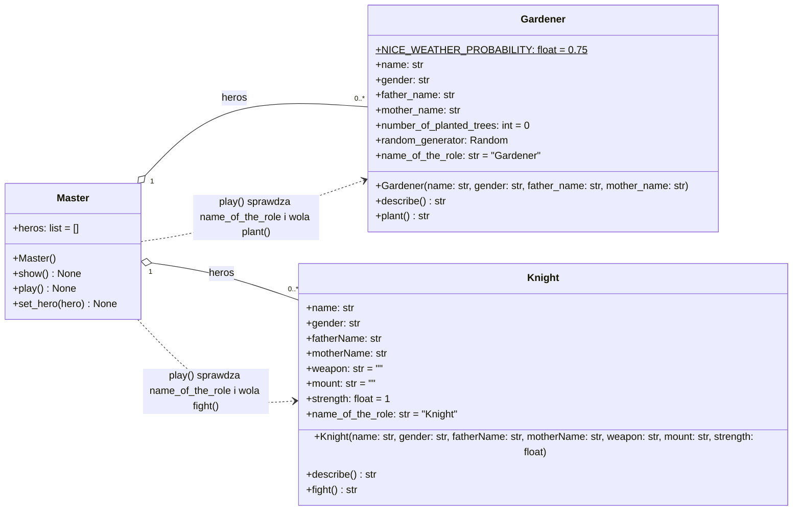
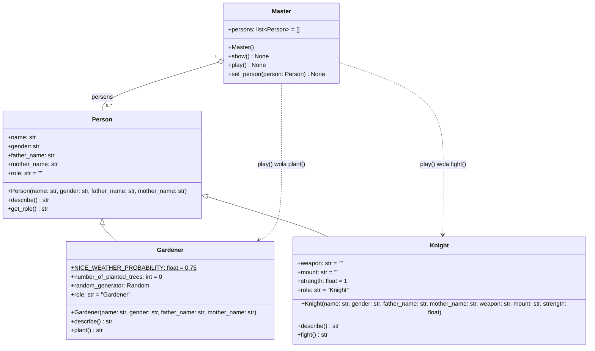
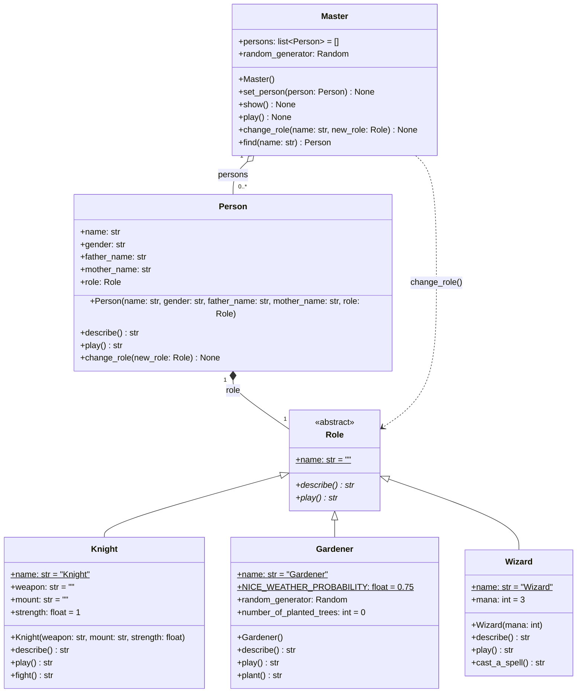

# ZPO 02. Zasady SOLID

Foldery `solid_1` i `solid_2` zawierają dwa przykłady kodu napisanego dla następującej sytuacji:

> Mieszkańcy miasta Green Dragon mogą odgrywać różne role, np. ogrodnika, rycerza itp. Ogrodnik
> sadzi drzewa, gdy pogoda jest ładna, a gdy pada deszcz – przygląda się rosnącym drzewom. Rycerz
> walczy przy użyciu broni (np. miecza, łuku) i jeździ na wierzchowcu (np. koniu, smoku). W trakcie
> walki jego siła maleje, więc gdy się zmęczy, musi odpocząć.
>
> Każdy mieszkaniec jest scharakteryzowany przez imię, płeć oraz imiona swoich rodziców.
> Mieszkaniec (np. pan Greenleaf, syn Brightstar i Bravewolfa) może odgrywać różne role – na
> przykład być rycerzem, a następnie zmienić rolę na czarodzieja.
>
> Mistrz miasta przechowuje informacje o wszystkich mieszkańcach (listę wszystkich mieszkańców),
> potrafi ich wyświetlić (metoda `show()`) oraz nakazać im odgrywać swoje role (metoda `play()`).
> Może także zmieniać role mieszkańców.

## 1. Diagramy klas UML dla programów `solid_1` i `solid_2`

> **Zadanie 1.** Narysuj diagramy klas UML dla programów „solid_1" i „solid_2".

Notacja: `+` oznacza składową publiczną (w Pythonie wszystkie składowe są publiczne),
podkreślenie oznacza składową statyczną (atrybut klasy), `nazwa: typ = wartość` to atrybut
z wartością początkową nadawaną w konstruktorze. Konstruktor jest pokazany po UML-owemu jako
operacja o nazwie klasy (w Pythonie to metoda `__init__`). Typy są wywnioskowane z kodu, bo
programy nie mają adnotacji typów.

### 1.1. Program `solid_1`



Pełny spis tego, co jest w kodzie i skąd się wzięło na diagramie:

| Klasa | Konstruktor | Atrybuty instancji | Atrybuty klasy | Metody |
|---|---|---|---|---|
| `Gardener` | `(name, gender, father_name, mother_name)` | `name`, `gender`, `father_name`, `mother_name`, `number_of_planted_trees = 0`, `random_generator = random.Random()`, `name_of_the_role = "Gardener"` | `NICE_WEATHER_PROBABILITY = 0.75` | `describe() -> str`, `plant() -> str` |
| `Knight` | `(name, gender, fatherName, motherName, weapon="", mount="", strength=1)` | `name`, `gender`, `fatherName`, `motherName`, `weapon`, `mount`, `strength`, `name_of_the_role = "Knight"` | – | `describe() -> str`, `fight() -> str` |
| `Master` | `()` | `heros = []` | – | `show() -> None`, `play() -> None`, `set_hero(hero) -> None` |

Relacje:

- **Agregacja** `Master ◇── Gardener` i `Master ◇── Knight` (1 do 0..*): `Master` trzyma
  bohaterów na liście `heros`, ale ich nie tworzy. Obiekty powstają w `main()` i są przekazywane
  przez `set_hero()`, więc żyją niezależnie od `Master`. Lista nie ma wspólnego typu elementu,
  stąd dwie osobne agregacje.
- **Zależność** `Master ┄┄> Gardener` i `Master ┄┄> Knight`: `play()` porównuje
  `hero.name_of_the_role` z napisami `"Knight"` / `"Gardener"` i na tej podstawie wywołuje
  `fight()` albo `plant()`. `Master` musi więc znać obie konkretne klasy i ich metody.
- `Gardener.random_generator` to instancja bibliotecznej klasy `random.Random`, `Master.play()`
  korzysta z funkcji `choice` i `uniform` z modułu `random`, a `main.py` tworzy `Master`,
  dwóch `Gardener` i dwóch `Knight`. To zależności od biblioteki standardowej i modułów, nie
  relacje między klasami programu, dlatego nie ma ich na diagramie.

Co diagram ujawnia:

- `Gardener` i `Knight` **nie mają wspólnej klasy bazowej**. Cechy mieszkańca (imię, płeć,
  imiona rodziców) są zduplikowane w obu klasach, w dodatku pod różnymi nazwami
  (`father_name` vs `fatherName`).
- Wspólny „interfejs" (`describe()` i atrybut `name_of_the_role`) istnieje tylko umownie, przez
  duck typing. Nic w kodzie go nie wymusza, a `Master` polega na nim w `show()` i `play()`.
- Rola jest tożsama z klasą obiektu i dodatkowo zduplikowana jako napis w `name_of_the_role`.

### 1.2. Program `solid_2`



Pełny spis:

| Klasa | Konstruktor | Atrybuty instancji | Atrybuty klasy | Metody |
|---|---|---|---|---|
| `Person` | `(name, gender, father_name, mother_name)` | `name`, `gender`, `father_name`, `mother_name`, `role = ""` | – | `describe() -> str`, `get_role() -> str` |
| `Gardener(Person)` | `(name, gender, father_name, mother_name)`, woła `super().__init__` | dziedziczone + `number_of_planted_trees = 0`, `random_generator = random.Random()`; nadpisuje wartość `role = "Gardener"` | `NICE_WEATHER_PROBABILITY = 0.75` | nadpisuje `describe() -> str`; dodaje `plant() -> str` |
| `Knight(Person)` | `(name, gender, father_name, mother_name, weapon="", mount="", strength=1)`, woła `super().__init__` | dziedziczone + `weapon`, `mount`, `strength`; nadpisuje wartość `role = "Knight"` | – | nadpisuje `describe() -> str`; dodaje `fight() -> str` |
| `Master` | `()` | `persons = []` (lista `Person`) | – | `show() -> None`, `play() -> None`, `set_person(person) -> None` |

Uwaga do diagramu: `role` w `Gardener` i `Knight` to **ten sam atrybut odziedziczony po
`Person`**, pokazany w podklasach tylko dlatego, że każda z nich nadaje mu inną wartość
początkową. Podklasy nie wprowadzają nowego pola.

Relacje:

- **Generalizacja** `Gardener ──▷ Person` i `Knight ──▷ Person`: podklasy przejmują cechy
  mieszkańca i `get_role()`, nadpisują `describe()`.
- **Agregacja** `Master ◇── Person` (1 do 0..*): `Master` trzyma listę `persons`, a elementy
  powstają w `main()` i trafiają do niej przez `set_person()`. Dzięki wspólnej klasie bazowej
  wystarczy jedna agregacja.
- **Zależność** `Master ┄┄> Gardener` i `Master ┄┄> Knight`: `play()` sprawdza
  `get_role() == "Knight"` i wywołuje `fight()` albo `plant()`, czyli metody, których
  **nie ma w `Person`**. Mimo agregacji po typie bazowym `Master` nadal zna konkretne podklasy.

Co diagram ujawnia:

- Wspólne cechy mieszkańca są w jednym miejscu (`Person`), duplikacja z `solid_1` zniknęła.
- `Master` agreguje już `Person`, ale `play()` wciąż rozgałęzia się po napisie z `get_role()`
  i woła metody podklas. Gałąź `else` zakłada, że wszystko, co nie jest rycerzem, umie `plant()`.
- Rola jest nadal **tożsama z klasą obiektu** (rycerz to instancja `Knight`), więc zmiana roli
  mieszkańca wymaga utworzenia nowego obiektu innej klasy i przepisania do niego cech osoby.

## 2. Zmiany potrzebne w programach `solid_1` i `solid_2`

> **Zadanie 2.** Wskaż i wyjaśnij (nie pisz kodu), jakie zmiany należałoby wprowadzić w kodzie
> programów „solid_1" i „solid_2" w następujących przypadkach (tzn. co trzeba dodać/zmodyfikować
> w klasach, metodach itp.).

### 2a. Do cech mieszkańca dodany zostanie nowy atrybut `date_of_birth`

**`solid_1`.** Z racji braku klasy reprezentującej mieszkańca trzeba zmodyfikować każdą klasę
roli osobno (`Gardener`, `Knight`), dodając nowy parametr konstruktora i atrybut instancji.
Dodatkowo trzeba poprawić wszystkie miejsca tworzenia obiektów (`main.py` oraz funkcje `main()`
w modułach), a w przypadku wyświetlania tej danej zmienić implementację `describe()` w obu
klasach. Koszt zmiany rośnie z liczbą ról.

**`solid_2`.** Nowy atrybut dodaje się raz, w konstruktorze klasy bazowej `Person` (i w jej
`describe()`, jeśli ma być wyświetlany). Mimo to trzeba dotknąć także obu podklas: ich
konstruktory przekazują do `super().__init__` jawnie wyliczone argumenty, więc muszą przyjąć
i przekazać `date_of_birth`, a ich `describe()` nadpisują opis w całości bez wywołania
`super().describe()`, więc wyświetlenie daty wymaga zmiany również w nich. Miejsca tworzenia
obiektów trzeba poprawić tak samo jak w `solid_1`.

**Wniosek.** `solid_2` lokalizuje zmianę modelu danych w `Person`, ale sposób napisania podklas
sprawia, że i tak trzeba edytować każdą klasę roli. Gdyby podklasy przekazywały argumenty bazowe
bez ich wyliczania i budowały opis z `super().describe()`, zmiana zamknęłaby się w jednej klasie.

### 2b. Utworzona zostanie nowa rola, np. czarodziej z metodą `cast_a_spell`

**`solid_1`.** Trzeba dodać nową klasę `Wizard`, w której ponownie trzeba skopiować wszystkie
cechy mieszkańca (imię, płeć, imiona rodziców), ustawić `name_of_the_role = "Wizard"` oraz
napisać `describe()` i `cast_a_spell()`. Sama nowa klasa nie wystarczy: trzeba zmodyfikować
`Master.play()`, dopisując kolejną gałąź `elif hero.name_of_the_role == "Wizard"`, bo to
`Master` decyduje, którą metodę wywołać dla której roli. Do tego dochodzi tworzenie czarodziejów
w `main.py`.

**`solid_2`.** Nowa klasa `Wizard(Person)` jest prostsza, bo cechy mieszkańca dziedziczy po
`Person`; wystarczy ustawić `role = "Wizard"` i dodać `describe()` oraz `cast_a_spell()`.
`Master.play()` nadal jednak trzeba zmienić, i to pilnie: obecna logika to
`if role == "Knight": fight() else: plant()`, więc czarodziej bez modyfikacji trafia do gałęzi
`else` i program kończy się błędem `AttributeError`, bo `Wizard` nie ma metody `plant()`.
Potrzebna jest kolejna gałąź `elif` dla roli `"Wizard"`.

**Wniosek.** W obu programach dodanie roli oznacza nie tylko nową klasę, ale też edycję
istniejącej klasy `Master`. Wspólna klasa bazowa w `solid_2` ułatwia napisanie nowej roli,
ale nie pomaga `Master`, bo czynność właściwa dla roli (`fight`, `plant`, `cast_a_spell`) nie
jest częścią interfejsu `Person`, tylko każdej podklasy z osobna, pod inną nazwą.

### 2c. Zarządca miasta chce przydzielić nową rolę osobie, która obecnie „pracuje" jako rycerz

**`solid_1`.** Rola jest tożsama z klasą obiektu: rycerz to po prostu instancja `Knight`, a jego
cechy jako mieszkańca są zapisane w tym samym obiekcie co broń, wierzchowiec i siła. Nie da się
więc „zmienić roli" istniejącego obiektu. Trzeba dodać do `Master` nową metodę (np.
`change_role`), która utworzy nowy obiekt klasy docelowej, ręcznie przepisze do niego imię,
płeć i imiona rodziców ze starego obiektu, usunie stary obiekt z listy `heros` i wstawi nowy.
Taka metoda musi znać konstruktory wszystkich klas ról, a te różnią się listą parametrów
i nawet nazwami pól (`fatherName` w `Knight`, `father_name` w `Gardener`), więc każda nowa rola
wymaga kolejnej gałęzi w `change_role`. Mieszkaniec traci tożsamość obiektu (każda zewnętrzna
referencja wskazuje na stary obiekt) oraz cały stan poprzedniej roli.

**`solid_2`.** Problem jest ten sam, bo mimo klasy `Person` rola nadal jest tożsama z podklasą.
Samo przypisanie `person.role = "Wizard"` nic nie daje: obiekt dalej jest instancją `Knight`,
nie ma metody `cast_a_spell()`, a `Master.play()` po napisie z roli wywoła metodę, której nie ma.
Trzeba więc, jak w `solid_1`, dodać do `Master` metodę tworzącą nowy obiekt docelowej podklasy,
kopiującą pola odziedziczone po `Person` i podmieniającą element na liście `persons`. Jest
nieco łatwiej, bo zestaw cech do przepisania jest zdefiniowany w jednym miejscu (`Person`),
ale `Master` nadal musi znać konstruktory konkretnych podklas i rozgałęziać się po roli.

**Wniosek.** W obu programach zmiana roli nie jest operacją na mieszkańcu, tylko wymianą obiektu
na inny, z ręcznym kopiowaniem cech. Przyczyna jest strukturalna: dziedziczenie wiąże rolę
z typem obiektu na stałe, w momencie jego utworzenia. Żeby rola była wymienna, musi być
osobnym obiektem, który mieszkaniec **ma**, a nie typem, którym mieszkaniec **jest**. To
właśnie jest punktem wyjścia dla projektu w zadaniu 4.

## 3. Czy programy „solid_1" i „solid_2" spełniają zasady SOLID? Jeżeli nie, to wskaż, które z zasad nie są spełnione i wyjaśnij dlaczego – podaj przykłady (jeden przykład na pojedynczą niespełnioną zasadę SOLID)

### S – Single Responsibility Principle

Żadna implementacja nie spełnia tej zasady w 100%. W `solid_1` klasy `Gardener` i `Knight`
łączą odpowiedzialność mieszkańca (imię, płeć, rodzice) z wykonywaniem pracy roli, więc np.
dodanie `date_of_birth` wymusza zmianę klasy, której celem jest walka. Dodatkowo `Master`
podejmuje decyzje na bazie roli mieszkańca (`if hero.name_of_the_role == "Knight"`), więc musi
po części rozumieć ich implementacje. W `solid_2` sytuacja jest trochę lepsza, ponieważ
`Person` rozdziela dane mieszkańca od jego roli, jednak nadal pozostaje problem z `Master`,
a `describe()` w podklasach i tak formatuje dane osobowe od nowa zamiast użyć `super()`.

### O – Open/Closed Principle

Niespełniona w obu programach. Nowa rola nie jest rozszerzeniem, tylko modyfikacją: przy każdej
nowej roli, np. `Wizard` z `cast_a_spell()`, trzeba dopisać w `Master.play()` kolejną gałąź
`elif`. Bez tego w `solid_1` czarodziej na liście po prostu nic nie robi, a w `solid_2` trafia
do gałęzi `else` i program przerywa się błędem `AttributeError`, bo nie ma metody `plant()`.

### L – Liskov Substitution Principle

W `solid_1` nie dotyczy, bo nie ma dziedziczenia. W `solid_2` podklasy honorują kontrakt
`Person` (`describe()`, `get_role()`), więc tam, gdzie `Master` używa tylko tych metod, np.
w `show()`, zasada jest spełniona. `play()` wymaga jednak więcej, niż `Person` obiecuje: czysty
obiekt `Person` na liście wywołałby błąd. To brak operacji w klasie bazowej, a nie wina
podklas, dlatego ten problem zaliczamy do O i D.

### I – Interface Segregation Principle

Nie jest łamana w żadnym z programów. Nigdzie nie ma „grubego" interfejsu, który zmuszałby
klasę do implementowania niepotrzebnych metod, a interfejs `Person` jest wręcz minimalny.
Problemem obu programów jest brak abstrakcji dla czynności roli, a nie jej nadmiar.

### D – Dependency Inversion Principle

Niespełniona w obu programach. `Master`, czyli moduł wysokiego poziomu, zależy wprost od
konkretnych klas. W `solid_1` importuje `Gardener` i `Knight` i woła ich metody po rozpoznaniu
napisu z rolą. W `solid_2` korzysta z abstrakcji `Person` tylko w `show()` i `set_person()`,
a w `play()` woła `fight()` i `plant()`, które istnieją wyłącznie w podklasach.

### Podsumowanie

| Zasada | `solid_1` | `solid_2` |
|---|---|---|
| S | niespełniona | częściowo |
| O | niespełniona | niespełniona |
| L | nie dotyczy | spełniona |
| I | nie jest łamana | nie jest łamana |
| D | niespełniona | niespełniona |

Wspólny mianownik: brak jednej abstrakcji „czynność roli", przez którą `Master` mógłby nakazać
każdemu mieszkańcowi pracę bez wiedzy, kim on jest. `solid_2` rozwiązuje duplikację danych
osobowych, ale tego sedna nie dotyka.

## 4. Zaproponuj projekt programu, który umożliwi łatwą (zgodną z zasadami SOLID) zmianę ról mieszkańców (bohaterów), np. osoba o imieniu Quickhand będąca obecnie rycerzem będzie mogła „awansować" na stanowisko czarodzieja. Narysuj odpowiedni diagram klas UML i napisz kod

### Idea projektu

Wniosek z zadań 2 i 3 był jeden: rola nie może być **typem**, którym mieszkaniec jest, tylko
**obiektem**, który mieszkaniec ma. Projekt opiera się więc na kompozycji zamiast dziedziczenia
(wzorzec Strategia):

- `Person` reprezentuje wyłącznie mieszkańca: imię, płeć, imiona rodziców oraz **wskazanie na
  aktualną rolę**. Nie wie, jakie role istnieją. `play()` deleguje pracę do roli, `describe()`
  skleja nazwę roli, dane osoby i opis roli (w formacie znanym z `solid_2`: „Knight Quickhand,
  son of …"), a `change_role()` podmienia obiekt roli.
- `Role` to abstrakcyjna klasa bazowa z minimalnym kontraktem: `name`, `describe()` i `play()`.
  To jedyna rzecz, jaką `Person` i `Master` wiedzą o rolach.
- `Knight`, `Gardener`, `Wizard` dziedziczą po `Role`. Każda trzyma własny stan (broń
  i siła, liczba posadzonych drzew, mana) i własną metodę dziedzinową (`fight()`, `plant()`,
  `cast_a_spell()`), a `play()` jest polimorficznym wejściem, które tę metodę wywołuje.
- `Master` przechowuje listę `Person`, umie ją wyświetlić (`show()`), nakazać pracę (`play()`)
  i zmienić rolę wskazanej osobie (`change_role()`), przekazując jej gotowy obiekt `Role`.
  Nie ma w nim żadnego `if` po roli.

### Diagram klas UML



### Jak wygląda awans Quickhanda

1. `main` tworzy `Person("Quickhand", "m", "Bravedeed", "Sunbell", Knight("sword", "horse"))`
   i dodaje go do `Master`.
2. `master.change_role("Quickhand", Wizard())` odnajduje osobę po imieniu i woła
   `person.change_role(Wizard())`.
3. `Person` podmienia atrybut `role`. Obiekt osoby pozostaje ten sam (ta sama tożsamość, te same
   dane mieszkańca, ta sama pozycja na liście), a stan rycerza (broń, siła) znika razem
   z odrzuconym obiektem `Knight`, bo należał do roli, nie do osoby.
4. Kolejne `master.play()` wywoła `person.play()`, a ten `Wizard.play()`, czyli `cast_a_spell()`,
   bez żadnej zmiany w `Master` ani w `Person`.

### Dlaczego to spełnia SOLID

- **S**: `Person` odpowiada za tożsamość mieszkańca, każda podklasa `Role` za jedną pracę,
  `Master` za prowadzenie miasta. Każda klasa ma jeden powód do zmiany.
- **O**: nową rolę dodaje się nową podklasą `Role`. `Master`, `Person` ani istniejące role nie
  wymagają edycji.
- **L**: każda podklasa `Role` spełnia ten sam kontrakt (`name`, `describe()`, `play()`), więc
  `Person` może trzymać dowolną z nich i nie zauważy różnicy.
- **I**: kontrakt `Role` ma trzy składowe i każda ma klienta w `Person`: `describe()` czyta
  `name` i `describe()` roli, `play()` woła `play()` roli. Metody dziedzinowe (`fight()`,
  `plant()`, `cast_a_spell()`) zostają w podklasach i nikt poza nimi nie musi o nich wiedzieć.
- **D**: `Master` i `Person` zależą wyłącznie od abstrakcji `Role`. Konkretne role są tworzone
  na zewnątrz (w `main`) i wstrzykiwane przez konstruktor `Person` albo `change_role()`.

### Kod

Program jest w folderze `lesson-one/solid_3/`, w takim samym układzie jak `solid_1` i `solid_2`
(jedna klasa na plik, uruchamianie z wnętrza folderu):

| Plik | Zawartość |
|---|---|
| `role.py` | abstrakcyjna klasa `Role` (`name`, `describe()`, `play()`) |
| `knight.py`, `gardener.py`, `wizard.py` | konkretne role; każda ma własny stan i metodę dziedzinową (`fight()`, `plant()`, `cast_a_spell()`), a `play()` ją wywołuje |
| `person.py` | mieszkaniec z aktualną rolą; `play()` i `describe()` delegują do roli, `change_role()` ją podmienia |
| `master.py` | lista mieszkańców, `set_person()`, `show()`, `play()`, `change_role(name, new_role)` |
| `main.py` | demonstracja: miasto pracuje, Quickhand awansuje na czarodzieja, miasto pracuje dalej |

```bash
cd studies/advanced-object-programming/lesson-one/solid_3
python main.py
```

Dwie decyzje implementacyjne wykraczające poza diagram z projektu: `Master` trzyma generator
losowy w atrybucie `random_generator`, tak jak `Gardener` w oryginale, zamiast wołać funkcje
modułu `random`; `Master.find()` zgłasza `LookupError` dla nieznanego imienia zamiast po cichu
nic nie robić. Tak jak w `solid_1` i `solid_2` każdy moduł ma na końcu własne `main()` z małym
demo klasy; w `person.py` i `master.py` importy konkretnych ról są wewnątrz `main()`, żeby same
klasy `Person` i `Master` nie zależały od żadnej konkretnej roli.

Fragment wyjścia `main.py` w momencie awansu (wartości liczbowe zależą od losowania):

```text
Quickhand is promoted to wizard.

List of inhabitants:

Persons: 
Gardener Greenleaf, son of Brownleaf and Goldendaisy. Planted 5 trees.
Gardener Slenderwillow, daughter of Oldoak and Sunnydaisy. Planted 12 trees.
Wizard Quickhand, son of Bravedeed and Sunbell. Casts spells, 3 mana left.
Knight Truefriend, son of Highspirit and Mistymorning. Fights using a spear, rides on a dragon.

Working person: Wizard Quickhand, son of Bravedeed and Sunbell. Casts spells, 3 mana left.
Casting a spell...
Casting a spell...
```

Quickhand pozostał tym samym obiektem na tej samej pozycji listy, zmieniła się tylko jego rola,
a `Master` i `Person` nie zawierają ani jednej linii specyficznej dla czarodzieja.

#### Listing

`solid_3/role.py`

```python
from abc import ABC, abstractmethod


class Role(ABC):
    name = ""

    @abstractmethod
    def describe(self): ...

    @abstractmethod
    def play(self): ...
```

`solid_3/knight.py`

```python
from role import Role


class Knight(Role):
    name = "Knight"

    def __init__(self, weapon="", mount="", strength=1):
        self.weapon = weapon
        self.mount = mount
        self.strength = strength

    def describe(self):
        return "Fights using a {0}, rides on a {1}.".format(self.weapon, self.mount)

    def play(self):
        return self.fight()

    def fight(self):
        if self.strength <= 0:
            self.strength = 1.0
            return "   Resting..."
        self.strength -= 0.25
        return "Figting..."


def main():
    k = Knight("sword", "horse")
    print(k.describe())
    for i in range(6):
        print(k.fight())


if __name__ == "__main__":
    main()
```

`solid_3/gardener.py`

```python
import random

from role import Role


class Gardener(Role):
    name = "Gardener"
    NICE_WEATHER_PROBABILITY = 0.75

    def __init__(self):
        self.random_generator = random.Random()
        self.number_of_planted_trees = 0

    def describe(self):
        return "Planted {0} trees.".format(self.number_of_planted_trees)

    def play(self):
        return self.plant()

    def plant(self):
        if self.random_generator.random() < self.NICE_WEATHER_PROBABILITY:
            self.number_of_planted_trees += 1
            return "Planting a tree..."
        return "Looking at trees growing in the rain..."


def main():
    g = Gardener()
    print(g.describe())
    for i in range(6):
        print(g.plant())


if __name__ == "__main__":
    main()
```

`solid_3/wizard.py`

```python
from role import Role


class Wizard(Role):
    name = "Wizard"

    def __init__(self, mana=3):
        self.mana = mana

    def describe(self):
        return "Casts spells, {0} mana left.".format(self.mana)

    def play(self):
        return self.cast_a_spell()

    def cast_a_spell(self):
        if self.mana <= 0:
            self.mana = 3
            return "Meditating to restore mana..."
        self.mana -= 1
        return "Casting a spell..."


def main():
    w = Wizard()
    print(w.describe())
    for i in range(6):
        print(w.cast_a_spell())


if __name__ == "__main__":
    main()
```

`solid_3/person.py`

```python
class Person:
    def __init__(self, name, gender, father_name, mother_name, role):
        self.name = name
        self.gender = gender
        self.father_name = father_name
        self.mother_name = mother_name
        self.role = role

    def describe(self):
        return "{0} {1}, {2} of {3} and {4}. {5}".format(
            self.role.name, self.name, "son" if self.gender == "m" else "daugher",
            self.father_name, self.mother_name, self.role.describe())

    def play(self):
        return self.role.play()

    def change_role(self, new_role):
        self.role = new_role


def main():
    from knight import Knight
    from wizard import Wizard

    p = Person("Quickhand", "m", "Bravedeed", "Goldendaisy", Knight("sword", "horse"))
    print(p.describe())
    print(p.play())
    p.change_role(Wizard())
    print(p.describe())
    print(p.play())


if __name__ == "__main__":
    main()
```

`solid_3/master.py`

```python
import random


class Master:
    def __init__(self):
        self.persons = []
        self.random_generator = random.Random()

    def set_person(self, person):
        self.persons.append(person)

    def show(self):
        print("\nPersons: ")
        for p in self.persons:
            print(p.describe())

    def play(self):
        for i in range(10):
            person = self.random_generator.choice(self.persons)
            print("\nWorking person:", person.describe())
            while True:
                print(person.play())
                if self.random_generator.uniform(0, 1) >= 0.75:
                    break

    def change_role(self, name, new_role):
        self.find(name).change_role(new_role)

    def find(self, name):
        for p in self.persons:
            if p.name == name:
                return p
        raise LookupError("No inhabitant named " + name)


def main():
    from gardener import Gardener
    from knight import Knight
    from person import Person
    from wizard import Wizard

    m = Master()
    m.set_person(Person("Greenleaf", "m", "Brownleaf", "Goldendaisy", Gardener()))
    m.set_person(Person("Slenderwillow", "f", "Oldoak", "Sunnydaisy", Gardener()))
    m.set_person(Person("Quickhand", "m", "Bravedeed", "Sunbell", Knight("sword", "horse")))
    m.set_person(Person("Truefriend", "m", "Highspirit", "Mistymorning", Knight("spear", "dragon")))
    m.show()
    m.play()
    m.change_role("Quickhand", Wizard())
    m.show()
    m.play()


if __name__ == "__main__":
    main()
```

`solid_3/main.py`

```python
from gardener import Gardener
from knight import Knight
from master import Master
from person import Person
from wizard import Wizard


def main():
    print("\n\nSOLID exercise 4\n")
    master = Master()
    master.set_person(Person("Greenleaf", "m", "Brownleaf", "Goldendaisy", Gardener()))
    master.set_person(Person("Slenderwillow", "f", "Oldoak", "Sunnydaisy", Gardener()))
    master.set_person(Person("Quickhand", "m", "Bravedeed", "Sunbell", Knight("sword", "horse")))
    master.set_person(Person("Truefriend", "m", "Highspirit", "Mistymorning", Knight("spear", "dragon")))
    print("\nList of inhabitants:\n")
    master.show()
    print("\nPlaying:\n")
    master.play()

    print("\n\nQuickhand is promoted to wizard.\n")
    master.change_role("Quickhand", Wizard())
    print("\nList of inhabitants:\n")
    master.show()
    print("\nPlaying:\n")
    master.play()


if __name__ == "__main__":
    main()
```
