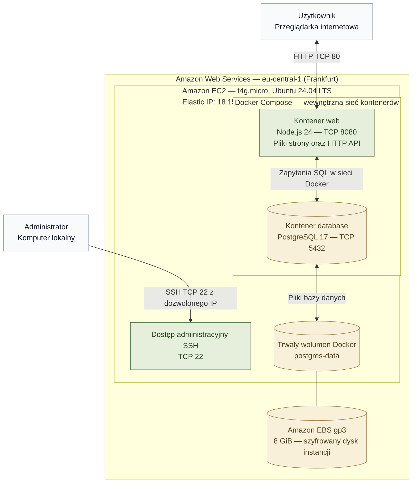

# Raport — uruchomienie serwisu internetowego w AWS EC2

**Autor:** Piotr Rybarczyk  
**Grupa:** MZ101  
**Numer albumu:** 10117  
**Przedmiot:** Cloud Computing  
**Data uruchomienia i opracowania raportu:** 16.11.2026

**Link do serwisu:** [http://18.159.151.130](http://18.159.151.130)

**Streszczenie.** Raport dokumentuje budowę i uruchomienie serwisu „Kocia adopcja” w Amazon EC2. Rozwiązanie obejmuje warstwę prezentacji w przeglądarce, aplikację HTTP w Node.js oraz bazę PostgreSQL. Aplikacja i baza działają w kontenerach Docker, a dane są utrwalane na dysku EBS. Motyw wizualny serwisu stanowią koty oraz zielona kolorystyka.

## 1. Cel i zakres opracowania

Celem zadania było uruchomienie publicznie dostępnego serwisu WWW przy użyciu usługi Amazon EC2. Przygotowany serwis „Kocia adopcja” umożliwia wirtualną adopcję kotów. Użytkownik nadaje kotu imię, zatwierdza adopcję i obserwuje animację otwarcia klatki oraz wyjścia kota na zewnątrz. Po odświeżeniu strony stan adopcji jest odtwarzany z bazy danych.

W nagłówku strony umieszczono etykietę wykonawcy: **Piotr Rybarczyk, grupa MZ101, nr albumu 10117**.

## 2. Wykorzystane usługi i technologie

| Element | Zastosowane rozwiązanie |
| --- | --- |
| Hosting | Amazon EC2 na prywatnym koncie AWS |
| Region | Frankfurt — `eu-central-1` |
| Typ instancji | `t4g.micro`, 2 vCPU, 1 GiB RAM, architektura ARM64 |
| System operacyjny | Ubuntu Server 24.04 LTS |
| Dysk | Szyfrowany Amazon EBS gp3, 8 GiB |
| Publiczny adres | Elastic IP `18.159.151.130` |
| Aplikacja | Node.js 24; frontend w HTML, CSS i JavaScript |
| Baza danych | PostgreSQL 17 |
| Uruchamianie aplikacji i bazy | Docker oraz Docker Compose |
| Grafika i animacje | Ilustracje SVG i animacje CSS |

Instancja ma identyfikator `i-05b78cae5435002ed`. Mały typ instancji i dysk o minimalnym rozmiarze wymaganym przez wybrany obraz systemu ograniczają zużycie zasobów.

## 3. Architektura rozwiązania

Poniższy diagram przedstawia architekturę logiczną wdrożenia oraz lokalizację danych trwałych.



*Rysunek 1. Architektura logiczna serwisu „Kocia adopcja” uruchomionego w Amazon EC2.*

Warstwa prezentacji odpowiada za formularze, animacje i wyświetlanie logu. Kontener `web` udostępnia pliki strony oraz API, natomiast kontener `database` przechowuje dane kotów, adopcji i aktywnego zestawu. Publiczny port 80 instancji jest mapowany na port 8080 aplikacji. Ruch przychodzący kontroluje Security Group: HTTP jest publiczny, a SSH ograniczony do dozwolonego adresu administratora. Port PostgreSQL nie jest publikowany na hoście.

Stan adopcji jest utrzymywany centralnie na serwerze i współdzielony przez wszystkich odwiedzających. Wolumen Docker znajduje się na dysku EBS, dlatego odtworzenie kontenera bazy nie wymaga usuwania zapisanych danych.

## 4. Budowa i uruchomienie

1. Przygotowano stronę z trzema kotami, formularzami nadawania imion, przyciskami adopcji oraz panelem pokazującym operacje odczytu i zapisu.
2. Zaimplementowano API w Node.js oraz zapis identyfikatora kota, nadanego imienia i czasu adopcji w PostgreSQL.
3. Przygotowano `Dockerfile` i konfigurację Docker Compose obejmującą dwa kontenery: `web` oraz `database`. Dla bazy skonfigurowano trwały wolumen `postgres-data`.
4. Na prywatnym koncie AWS uruchomiono instancję EC2 w regionie Frankfurt, przypisano dysk EBS i stały adres Elastic IP.
5. W grupie zabezpieczeń udostępniono port TCP 80 dla ruchu WWW. Dostęp administracyjny SSH na porcie 22 ograniczono do adresu IP komputera administratora. Baza danych nie ma portu opublikowanego w Internecie.
6. Archiwum projektu przesłano na instancję przez SSH/SCP. Na serwerze zainstalowano Docker Engine i Docker Compose z oficjalnego repozytorium Docker.
7. W pliku `.env` zapisano wygenerowane hasło bazy oraz konfigurację publikowania aplikacji: `APP_BIND_ADDRESS=0.0.0.0` i `APP_PORT=80`.
8. W katalogu projektu uruchomiono:

   ```sh
   docker compose up -d --build --wait
   ```

Kontener aplikacji nasłuchuje wewnętrznie na porcie 8080, udostępnionym jako port 80 instancji. Oba kontenery mają kontrolę gotowości oraz ustawienie `restart: unless-stopped`.

## 5. Zasada działania

Przepływ danych podczas adopcji jest następujący:

```text
Przeglądarka → HTTP API na EC2 → PostgreSQL w Dockerze
```

Przy otwarciu strony przeglądarka pobiera aktualny zestaw kotów i adopcje przez `GET /api/cats`. Po wpisaniu imienia i wybraniu „Adoptuj” wysyła `POST /api/adoptions`. Serwer sprawdza dane i zapisuje adopcję w PostgreSQL. Dopiero po potwierdzeniu zapisu interfejs otwiera klatkę i przesuwa kota na poduszkę poza nią.

Adopcje są wspólne dla wszystkich odwiedzających. Odświeżenie strony lub otwarcie jej na innym urządzeniu powoduje odczyt tego samego stanu z serwera. Ponowna próba adopcji już adoptowanego kota zwraca HTTP 409 i nie nadpisuje wcześniejszego imienia.

Przycisk „Losuj nowe koty” jest zawsze widoczny. Staje się aktywny po adopcji całej trójki. Wywołanie `POST /api/cats/draw` tworzy trzy nowe koty, losuje imiona i kolejność dostępnych wyglądów oraz zapisuje nowy aktywny zestaw. Poprzednie koty i adopcje pozostają w bazie. Transakcja z blokadą aktywnego zestawu zabezpiecza tę operację przed równoczesnym utworzeniem dwóch kolejnych zestawów.

Panel „Log operacji” pokazuje rzeczywiste żądania HTTP, ich statusy oraz potwierdzenia zapisu. Dane PostgreSQL znajdują się w wolumenie Dockera na dysku EBS, dzięki czemu są zachowywane po restarcie kontenerów.

## 6. Weryfikacja działania

Publiczny adres strony oraz endpointy `/health`, `/api/cats` i `/api/adoptions` odpowiadały poprawnie. Endpoint `/health` potwierdził połączenie aplikacji z PostgreSQL, a oba kontenery zgłosiły stan `healthy`. W przeglądarce potwierdzono obecność strony, etykiety wykonawcy i panelu logów.

Wykonano 12 testów automatycznych aplikacji i adapterów zapisu oraz test integracyjny PostgreSQL. Sprawdzono zapis i odczyt adopcji, zachowanie wcześniejszych danych podczas aktualizacji, równoczesne próby adopcji i losowania oraz odtworzenie aktywnego zestawu po ponownym połączeniu z bazą. Test integracyjny wykonano również na wdrożonej instancji, w osobnym schemacie testowym. Wszystkie wymienione testy zakończyły się poprawnie.

| Obszar weryfikacji | Kryterium poprawności | Wynik |
| --- | --- | --- |
| Dostępność publiczna | Odpowiedź strony i API przez publiczny adres HTTP | Potwierdzono |
| Identyfikacja wykonawcy | Widoczna etykieta z imieniem, nazwiskiem i grupą | Potwierdzono |
| Trwałość zapisu | Odczyt imienia i adopcji po ponownym połączeniu z bazą | Test zakończony poprawnie |
| Współbieżna adopcja | Jeden zapis i odrzucenie drugiej próby dla tego samego kota | Test zakończony poprawnie |
| Współbieżne losowanie | Utworzenie wyłącznie jednego nowego zestawu | Test zakończony poprawnie |
| Aktualizacja schematu | Zachowanie istniejących kotów i adopcji | Test zakończony poprawnie |

## 7. Zrzut ekranu

**Miejsce na własny zrzut ekranu wdrożonego serwisu.** Na zrzucie powinny być widoczne wygląd strony i etykieta wykonawcy; warto pokazać również adoptowanego kota oraz panel logów.

Po zapisaniu obrazu jako `zrzut-ec2.png` obok tego raportu można wstawić go następującą składnią Markdown:

```markdown

```

## 8. Udostępnienie do oceny

Serwis został uruchomiony 16.11.2026. Zgodnie z wymaganiami zadania instancję należy pozostawić dostępną **20.11.2026 w godzinach 20:00–22:00**. Raport sporządzono przed tym terminem, dlatego nie potwierdza on jeszcze dostępności w przyszłym oknie oceny. Po zaakceptowaniu zadania instancję można zatrzymać lub usunąć.

## 9. Dokumentacja

- [Amazon EC2 — zatrzymywanie i uruchamianie instancji](https://docs.aws.amazon.com/AWSEC2/latest/UserGuide/Stop_Start.html)
- [Docker — trwałe wolumeny](https://docs.docker.com/engine/storage/volumes/)
- [Docker Engine — instalacja w Ubuntu](https://docs.docker.com/engine/install/ubuntu/)
