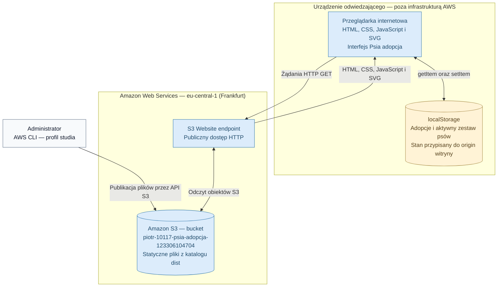

# Raport — uruchomienie serwisu internetowego w AWS S3

**Autor:** Piotr Rybarczyk  
**Grupa:** MZ101  
**Numer albumu:** 10117  
**Przedmiot:** Cloud Computing  
**Data uruchomienia i opracowania raportu:** 16.11.2026

**Link do serwisu:** [Psia adopcja — hosting Amazon S3](http://piotr-10117-psia-adopcja-123306104704.s3-website.eu-central-1.amazonaws.com)

**Streszczenie.** Raport dokumentuje budowę i publikację serwisu „Psia adopcja” z wykorzystaniem hostingu statycznego Amazon S3. Pliki aplikacji są dostarczane z bucketa, natomiast logika interfejsu oraz stan adopcji działają w przeglądarce odwiedzającego. Motyw wizualny obejmuje ilustracje psów, niebieską kolorystykę oraz wzór łap w tle.

## 1. Cel i zakres opracowania

Celem zadania było uruchomienie publicznie dostępnego serwisu WWW przy użyciu Amazon S3. Przygotowany serwis „Psia adopcja” przedstawia trzy animowane psy. Użytkownik nadaje psu imię i zatwierdza wirtualną adopcję. Po udanym zapisie otwierają się drzwiczki klatki, a pies wychodzi na zewnątrz. Odświeżenie strony zachowuje imię oraz stan adopcji.

W nagłówku umieszczono etykietę wykonawcy: **Piotr Rybarczyk, grupa MZ101, nr albumu 10117**.

## 2. Wykorzystane usługi i technologie

| Element | Zastosowane rozwiązanie |
| --- | --- |
| Hosting | Amazon S3 — Static website hosting |
| Konto | Prywatne konto AWS |
| Region | Frankfurt — `eu-central-1` |
| Bucket | `piotr-10117-psia-adopcja-123306104704` |
| Dokument indeksowy | `index.html` |
| Frontend | HTML, CSS i moduły JavaScript |
| Grafika i animacje | Ilustracje SVG i animacje CSS |
| Zapis stanu użytkownika | `localStorage` w przeglądarce |
| Udostępnianie strony | Publiczny S3 Website endpoint, HTTP |

S3 przechowuje i udostępnia pliki strony. Logika interfejsu oraz zapis adopcji wykonują się w przeglądarce, dlatego projekt nie wymaga uruchamiania serwera aplikacyjnego ani bazy danych na AWS.

## 3. Architektura rozwiązania

Diagram rozdziela infrastrukturę AWS, która udostępnia pliki strony, od urządzenia użytkownika, na którym zapisywane są adopcje.



*Rysunek 1. Architektura logiczna serwisu „Psia adopcja” z hostingiem statycznym Amazon S3.*

AWS S3 pełni rolę warstwy dystrybucji plików. Po ich pobraniu przeglądarka samodzielnie obsługuje formularze, animacje oraz zapis w `localStorage`. Adopcje nie są przesyłane do usługi S3 ani współdzielone z innymi odwiedzającymi. Ponowne otwarcie tego samego adresu w tej samej przeglądarce pozwala odczytać zapisany stan, o ile dane witryny nie zostały usunięte.

## 4. Budowa i publikacja

1. Przygotowano statyczną stronę z formularzami nadawania imion, przyciskami adopcji, animacjami psów oraz panelem „Log operacji”.
2. Zaimplementowano zapis i odczyt adopcji w `localStorage` oraz odtwarzanie stanu po odświeżeniu.
3. Uruchomiono polecenie:

   ```sh
   npm run build
   ```

   Polecenie przygotowało katalog `dist/` zawierający pliki HTML, CSS, JavaScript, SVG oraz publiczną konfigurację z danymi wykonawcy.

4. Na prywatnym koncie AWS utworzono osobny bucket S3 w regionie Frankfurt.
5. Włączono Static website hosting i ustawiono dokument indeksowy `index.html`.
6. Skonfigurowano politykę umożliwiającą publiczny odczyt obiektów przez `s3:GetObject`. Publiczne ACL pozostały blokowane. Konfiguracja dotyczyła wyłącznie bucketa przeznaczonego na tę stronę.
7. Za pomocą AWS CLI i profilu `studia` przesłano zawartość `dist/` do bucketa, zachowując strukturę plików. Dokument `index.html` znajduje się w katalogu głównym witryny.
8. Przy publikacji jawnie ustawiono typy zawartości:

   | Rodzaj pliku | Content-Type |
   | --- | --- |
   | HTML | `text/html` |
   | CSS | `text/css` |
   | Moduły `.mjs` | `text/javascript` |
   | Grafika SVG | `image/svg+xml` |

9. Sprawdzono dostępność publicznego adresu Website endpoint. Strona i moduły JavaScript zwróciły HTTP 200.

## 5. Zasada działania

Pobieranie strony i zapis adopcji odbywają się dwoma niezależnymi przepływami:

```text
Pobieranie plików: przeglądarka → Amazon S3
Zapis adopcji:     JavaScript → localStorage tej przeglądarki
```

Po otwarciu witryny przeglądarka pobiera z S3 pliki strony, a następnie odczytuje zapisany zestaw psów i adopcje. Wpisanie imienia oraz kliknięcie „Adoptuj” zapisuje identyfikator psa, imię i czas adopcji pod kluczem `koci-azyl.adoptions.v1.ID_KOTA`. Dopiero po udanym zapisie uruchamiana jest animacja otwarcia klatki i wyjścia psa.

Adopcja nie wysyła żądania do API. Panel logów pokazuje operacje `localStorage.getItem()` i `localStorage.setItem()`, dzięki czemu można obserwować źródło odczytywanych i zapisywanych danych.

Przycisk „Losuj nowe psy” jest zawsze widoczny i staje się aktywny po adopcji całej trójki. Tworzy trzy nowe identyfikatory, losuje imiona i kolejność dostępnych wyglądów, a aktywny zestaw zapisuje pod kluczem `koci-azyl.adoptions.v1.batch`. Poprzednie wpisy adopcji pozostają zachowane. Po odświeżeniu odtwarzana jest aktualna trójka.

Stan jest związany z adresem witryny i konkretną przeglądarką. Inny komputer lub inna przeglądarka ma niezależne adopcje. Usunięcie danych witryny usuwa lokalny zapis; w trybie prywatnym może on zniknąć po zamknięciu sesji.

## 6. Weryfikacja działania

Potwierdzono publiczną dostępność strony oraz obecność etykiety wykonawcy i panelu logów. Sprawdzono także poprawne typy zawartości modułów JavaScript, wymagane do ich uruchomienia w przeglądarce.

Wykonano dziesięć testów automatycznych. Obejmowały one między innymi odczyt wcześniej zapisanych adopcji, zgodność z zapisanym wcześniej zestawem, odtworzenie nowego zestawu przez ponownie utworzony adapter zapisu, blokadę przedwczesnego losowania, zachowanie historii oraz obsługę odmowy zapisu przez pamięć przeglądarki. Testy zakończyły się poprawnie.

| Obszar weryfikacji | Kryterium poprawności | Wynik |
| --- | --- | --- |
| Hosting statyczny | Publiczny odczyt strony i modułów JavaScript | Potwierdzono |
| Typy zawartości | Poprawne Content-Type plików HTML, CSS, MJS i SVG | Potwierdzono |
| Identyfikacja wykonawcy | Widoczna etykieta z imieniem, nazwiskiem i grupą | Potwierdzono |
| Odtwarzanie stanu | Odczyt adopcji i aktywnego zestawu z pamięci przeglądarki | Test zakończony poprawnie |
| Losowanie | Nowe identyfikatory i zachowanie wcześniejszych adopcji | Test zakończony poprawnie |
| Odmowa zapisu | Komunikat błędu i zachowanie poprzedniego stanu | Test zakończony poprawnie |

W przypadku błędu zapisu interfejs wyświetla komunikat, a pies pozostaje w klatce. Pozwala to uniknąć prezentowania adopcji, która nie została utrwalona.

## 7. Zrzut ekranu

**Miejsce na własny zrzut ekranu wdrożonego serwisu.** Warto pokazać etykietę wykonawcy, psy i panel z operacjami `localStorage`.

Po zapisaniu obrazu jako `zrzut-s3.png` obok tego raportu można wstawić go następującą składnią Markdown:

```markdown

```

## 8. Wynik realizacji

Serwis opublikowano w Amazon S3 i udostępniono w Internecie pod wskazanym na początku raportu adresem. Pliki strony są dostarczane przez S3, natomiast adopcje i aktualny zestaw psów są przechowywane lokalnie w przeglądarce odwiedzającego. Na stronie widoczna jest wymagana etykieta wykonawcy.

## 9. Dokumentacja

- [Amazon S3 — hosting statycznej strony](https://docs.aws.amazon.com/AmazonS3/latest/userguide/WebsiteHosting.html)
- [Amazon S3 — Website endpoints](https://docs.aws.amazon.com/AmazonS3/latest/userguide/WebsiteEndpoints.html)
- [MDN — localStorage](https://developer.mozilla.org/en-US/docs/Web/API/Window/localStorage)
